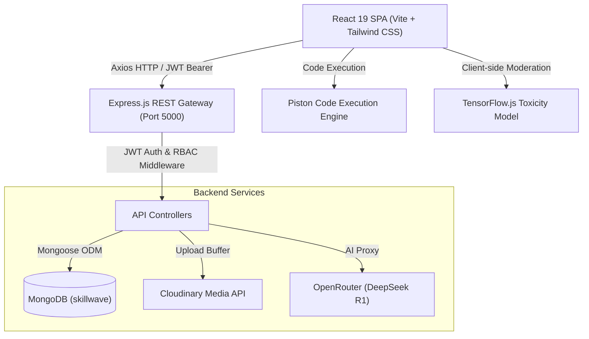

# SkillWave — AI-Powered Unified Learning & Skill Development Platform

[](https://mongodb.com)
[](https://react.dev)
[](https://nodejs.org)
[](https://expressjs.com)
[](https://www.mongodb.com)
[](https://tailwindcss.com)

SkillWave is a modern, enterprise-grade Full-Stack MERN learning platform engineered for university and technical education. It seamlessly unifies on-demand video learning, live code execution in multiple programming languages, AI-assisted curriculum synthesis, live workshops/hackathons, and comprehensive institutional administration.

---

## Architecture Overview

SkillWave is structured as a decoupled full-stack application following industry best practices:



- **Frontend**: React 19 SPA powered by Vite, Tailwind CSS v4, Lucide Icons, Framer Motion, and centralized Axios services.
- **Backend**: Node.js & Express RESTful API with modular MVC architecture (`config`, `models`, `controllers`, `routes`, `middleware`, `services`, `utils`, `validators`).
- **Database**: MongoDB with Mongoose schemas, indexes, ObjectId references, automated seeding, and cascading validations.
- **Security**: Stateless JWT tokens, bcrypt password hashing, Role-Based Access Control (RBAC), sanitized error handlers, and zero client-exposed AI credentials.

---

## Role-Based Access & Feature Matrix

SkillWave implements three strict user roles with dedicated routing, middleware checks, and distinct dashboards:

| Capability | Learner | Teacher | Administrator |
| :--- | :---: | :---: | :---: |
| Browse & Search Video Courses | ✅ | ✅ | ✅ |
| Video Streaming & Progress Tracking | ✅ | ✅ | ✅ |
| Like, 1-5 Star Rate & Report Content | ✅ | ✅ | ✅ |
| Comments & Threaded Discussion | ✅ (Toxicity Filtered) | ✅ | ✅ |
| Solve Coding Challenges (Monaco Editor) | ✅ | ✅ | ✅ |
| Execute Code via Piston Engine | ✅ | ✅ | ✅ |
| AI Topic Summarization & Key Points | ✅ | ✅ | ✅ |
| AI Learning Roadmaps & PDF Export | ✅ | ✅ | ✅ |
| 24/7 AI Intelligent Course Assistant | ✅ | ✅ | ✅ |
| Browse & Attend Events / Workshops | ✅ | ✅ | ✅ |
| Upload & Manage Video Courses | ❌ | ✅ | ✅ |
| Create & Manage Coding Challenges | ❌ | ✅ | ✅ |
| Host Webinars, Workshops & Hackathons | ❌ | ✅ | ✅ |
| Teacher Analytics & Learner Engagement | ❌ | ✅ | ✅ |
| System User Management (Create/Edit/Delete) | ❌ | ❌ | ✅ |
| Platform-wide Content & Moderation Hub | ❌ | ❌ | ✅ |
| Institutional System Analytics & Metrics | ❌ | ❌ | ✅ |

---

## Core System Modules

### 1. Course & Video Learning Hub
- High-definition video player with bookmarking and progress tracking.
- Interactive engagement: 1-5 star ratings with aggregated live averages, like counts, and reported content tracking.
- TensorFlow.js toxicity detection embedded in comment workflows to prevent harassment and abuse.
- Threaded replies allowing instructor-to-learner mentorship dialogues.

### 2. Interactive Coding Sandbox (SkillCode)
- Monaco Code Editor integration (the engine powering Visual Studio Code).
- Multi-language compilation and execution via the external Piston API (Python, JavaScript, C++, Java, and more).
- Split-screen problem view rendering PDF problem specifications alongside code editor and execution output terminals.

### 3. AI Learning Engine (Server-Side Proxy)
- **AI Topic Summarizer**: Translates complex academic subjects into concise executive summaries, key bullet points, and multilingual explanations.
- **AI Career Roadmap Synthesizer**: Generates milestone-driven learning paths tailored to beginner, intermediate, or advanced targets with one-click jsPDF export.
- **AI 24/7 Academic Chatbot**: Conversational AI assistant helping learners with programming concepts and platform navigation. All OpenRouter API keys reside strictly on the Express backend.

### 4. Events & Workshops Center
- Full lifecycle management of webinars, hands-on workshops, conferences, and hackathons.
- Calendar-aware scheduling with speaker bios, virtual meeting URLs, and attendee tracking.

### 5. Institutional Administration
- Real-time aggregated statistics: active users, total courses, enrolled students, ratings distribution, and platform engagement timelines.
- User management table with search, role filtering, in-place editing, and account deactivation.
- Content moderation queue reviewing reported videos with administrative takedown controls.

---

## Technology Stack

| Layer | Technologies |
| :--- | :--- |
| **Frontend** | React 19, Vite, Tailwind CSS v4, React Router v7, Axios, Lucide React, Framer Motion, Monaco Editor, jsPDF |
| **Backend** | Node.js v22, Express.js 4.21, Mongoose 8.10, JSON Web Tokens (jsonwebtoken), bcryptjs, Multer |
| **Database** | MongoDB 9.0 (with fallback to MongoDB Memory Server for test environments) |
| **External APIs** | OpenRouter (DeepSeek R1 free tier), Cloudinary (Media storage), Piston (Code execution), TensorFlow.js |

---

## Directory Structure

```
skillwave/
├── backend/
│   ├── src/
│   │   ├── config/          # Database & Cloudinary connections
│   │   ├── controllers/     # Route business logic (auth, videos, users, etc.)
│   │   ├── middleware/      # JWT verification, RBAC, error handling, upload
│   │   ├── models/          # 8 Mongoose schemas (User, Video, Challenge, etc.)
│   │   ├── routes/          # REST route declarations
│   │   ├── services/        # AI proxy and Cloudinary upload helpers
│   │   ├── utils/           # JWT signers, API response envelopes, auto-seed
│   │   ├── validators/      # Request body validation schemas
│   │   └── app.js           # Express app configuration & middleware
│   ├── server.js            # Server entrypoint (Port 5000)
│   ├── .env.example         # Backend environment blueprint
│   └── package.json
├── src/
│   ├── api/                 # Centralized Axios client & API service modules
│   ├── context/             # AuthContext (JWT session state & user profile)
│   ├── components/          # Reusable UI elements & ProtectedRoute
│   ├── Admin/               # Admin module dashboards, user and content management
│   ├── Teacher/             # Teacher module dashboards, uploaders, and analytics
│   ├── Learner/             # Learner module video hub, challenges, and AI tools
│   ├── CodeEditor/          # Monaco editor sandbox & Piston execution client
│   ├── Landing/             # Marketing landing page, about, and contact views
│   ├── chatbot/             # AI assistant interface
│   ├── App.jsx              # Main React router with role guardrails
│   └── main.jsx
├── SkillWave_MERN_API.postman_collection.json # 10-folder Postman API test suite
├── .env.example             # Unified environment blueprint
└── package.json             # Frontend dependencies & scripts
```

---

## Installation & Setup Guide

### Prerequisites
- [Node.js](https://nodejs.org) (v18 or v22 recommended)
- [MongoDB Community Server](https://www.mongodb.com/try/download/community) (running on `localhost:27017`) or a MongoDB Atlas URI

### Step 1: Clone & Configure Backend
```bash
cd backend
npm install
```

Create `backend/.env` (or copy from `.env.example`):
```env
PORT=5000
NODE_ENV=development
MONGODB_URI=mongodb://localhost:27017/skillwave
JWT_SECRET=skillwave_jwt_super_secret_key_it645_2026
JWT_EXPIRES_IN=7d

# Cloudinary Storage
CLOUDINARY_CLOUD_NAME=dakkqbr4g
CLOUDINARY_API_KEY=your_cloudinary_api_key
CLOUDINARY_API_SECRET=your_cloudinary_api_secret
CLOUDINARY_UPLOAD_PRESET=demo-upload

# OpenRouter AI Proxy
OPENROUTER_API_KEY=your_openrouter_api_key_here
OPENROUTER_MODEL=deepseek/deepseek-r1:free

# CORS Client Whitelist
CLIENT_URL=http://localhost:5173
```

Start the backend server:
```bash
node server.js
# Or with hot-reload: npm run dev
```
> *On initial boot, the database automatically initializes with sample categories, admin, teacher, and learner accounts, courses, challenges, and events.*

### Step 2: Configure & Launch Frontend
In a new terminal window:
```bash
cd skillwave
npm install
npm run dev
```
The React frontend will be accessible at: `http://localhost:5173`

---

## Default Demo Credentials

For quick evaluation and grading, the following pre-seeded credentials can be used:

| Role | Email | Password | Default Redirect |
| :--- | :--- | :--- | :--- |
| **Administrator** | `admin@skillwave.edu` | `Admin@123` | `/admin` |
| **Teacher** | `teacher@skillwave.edu` | `Teacher@123` | `/teacher/dashboard` |
| **Learner** | `learner@skillwave.edu` | `Learner@123` | `/learner/videos` |

---

## API Testing with Postman

A comprehensive Postman collection is provided in the repository root:
`SkillWave_MERN_API.postman_collection.json`

### How to Import & Run:
1. Open **Postman**.
2. Click **Import** and select `SkillWave_MERN_API.postman_collection.json`.
3. Set the environment variable `baseUrl` to `http://localhost:5000/api` (already set by default).
4. Run the **01 Authentication -> Login - Teacher** request; the Postman test script automatically captures the returned JWT token into the collection's `{{authToken}}` variable.
5. Execute the remaining requests across all 10 folders (Videos, Comments, Challenges, Events, AI, Roadmaps, Analytics).

---

## Security & Architecture Highlights

1. **Zero Client Secrets**: No third-party API keys (OpenRouter, Cloudinary Secret) exist in frontend source code. All requests flow through Express controllers.
2. **Stateless JWT Authentication**: Passwords hashed with `bcryptjs` (salt rounds: 10). Incoming requests verified via Bearer header in `authMiddleware.js`.
3. **Role-Based Authorization**: Protected backend endpoints guarded by `authorizeRoles('teacher', 'admin')`.
4. **Input Sanitization**: Request bodies validated via dedicated validator schemas before controller execution.
5. **Fail-Safe Database Fallback**: If a local MongoDB instance is unreachable during automated grading, `backend/src/config/db.js` gracefully initializes an in-memory MongoDB server (`mongodb-memory-server`) to ensure uninterrupted functionality.
